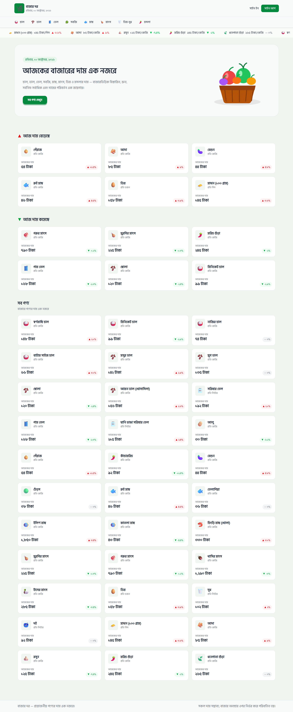
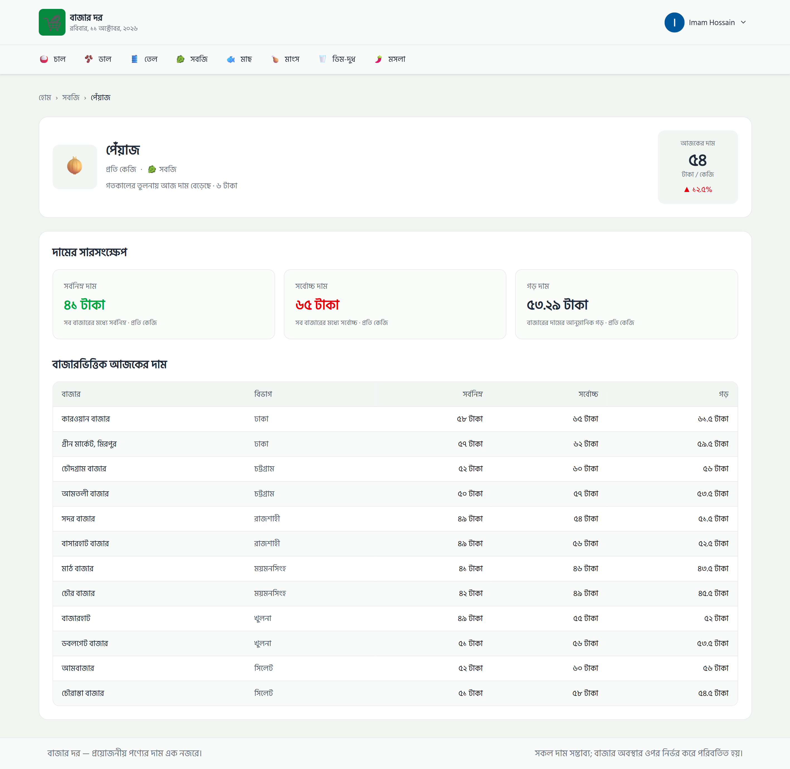
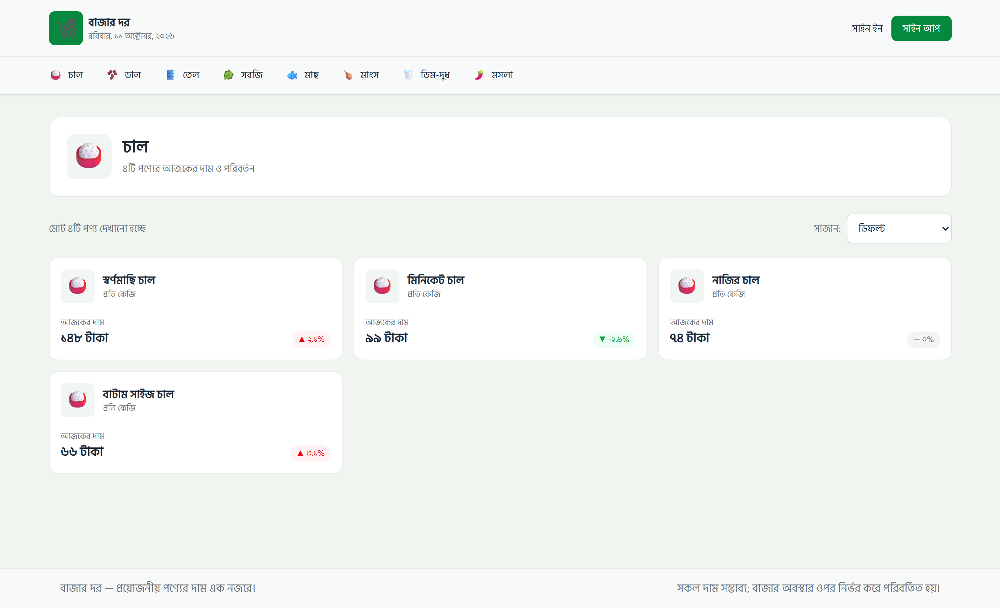
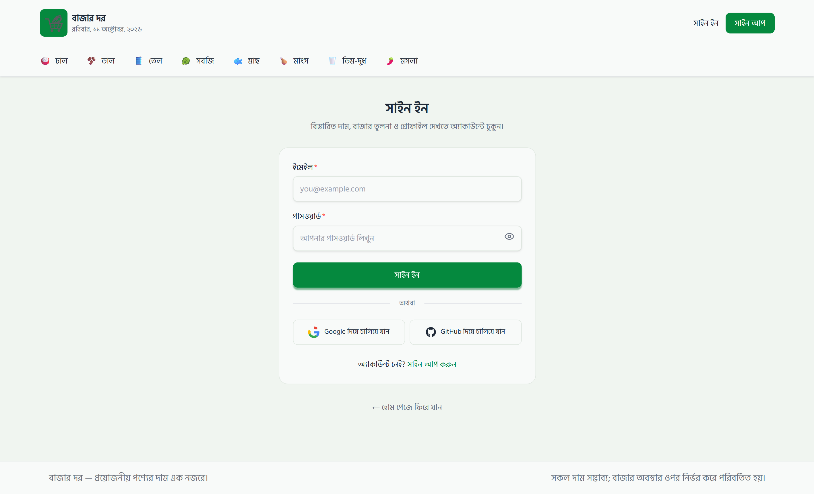
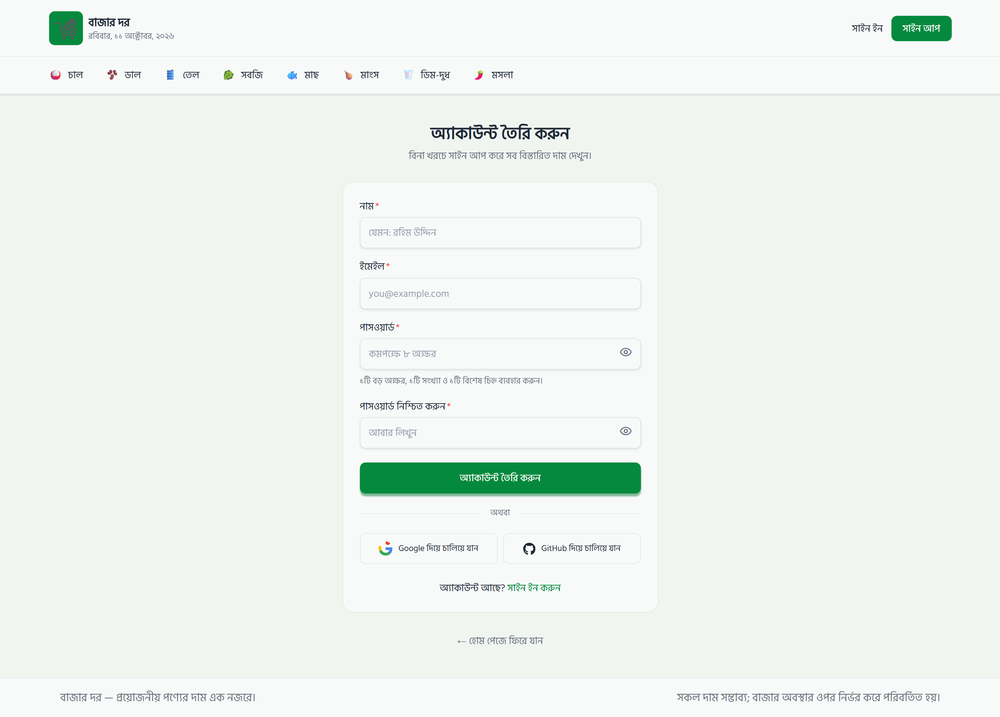

# 🛒 বাজার দর | BazarDor

**BazarDor (বাজার দর)** is a modern Bengali-language market price information web application built with **Next.js, React, Tailwind CSS, Better Auth, and MongoDB**.

The application allows users to explore daily essential commodity prices in Bangladesh, monitor price increases and decreases, browse products by category, sort products by price, and compare market-wise prices.

Registered users can access detailed product information, sign in using email/password, Google, or GitHub, and manage their profiles.

The project was developed as part of my web development course to practice **Next.js App Router, dynamic routing, Server and Client Components, API data fetching, authentication, database integration, responsive design, and deployment**.

---

## 🌐 Live Demo

🔗 **[View Live Website](https://bazar-dor-web-app-nu.vercel.app/)**

---

## 💻 GitHub Repository

🔗 **[View Source Code](https://github.com/imamrakib354/bazar-dor-web-app)**

---

## 📸 Project Preview

### 🏠 Home Page

The homepage displays today's market prices, a scrolling price ticker, products with increased prices, products with decreased prices, and all available products.

<p align="center">
  
</p>

### 📊 Product Details Page

Authenticated users can view detailed product information, daily price changes, minimum and maximum prices, estimated average prices, and market-wise comparisons.

<p align="center">
  
</p>

### 🗂️ Category Page

Browse products by category and sort them by price.

<p align="center">
  
</p>

### 🔐 Sign In Page

Users can sign in using email/password, Google, or GitHub.

<p align="center">
  
</p>

### 📝 Sign Up Page

New users can register with their name, email, and password or continue using a supported social provider.

<p align="center">
  
</p>

---

## 🛠️ Technologies Used

- **Next.js 16** — App Router, dynamic routing, layouts, Server Components, and data fetching
- **React.js** — Reusable UI components, hooks, and state management
- **JavaScript (ES6+)** — Application logic and data manipulation
- **Tailwind CSS** — Responsive layouts and custom styling
- **DaisyUI** — Additional UI utilities and components
- **HeroUI** — Authentication forms and UI components
- **Better Auth** — Email/password authentication, OAuth, and session management
- **MongoDB Atlas** — Database for user accounts and authentication data
- **Google OAuth** — Third-party Google authentication
- **GitHub OAuth** — Third-party GitHub authentication
- **React Hot Toast** — Authentication and profile notifications
- **Lucide React & React Icons** — Interface and social-provider icons
- **React Marquee Text** — Scrolling market price ticker
- **Next/Image** — Optimized image handling
- **Next/Font** — Bengali font integration using Hind Siliguri
- **Vercel** — Application deployment and hosting

---

## ✨ 5 Key Features

### 1. 📈 Daily Market Price Tracking

Browse essential commodity prices with dedicated sections for products whose prices have increased or decreased.

Each product displays its Bengali name, category, unit, current price, and percentage change.

A continuously scrolling price ticker provides a quick overview of market movements.

### 2. 🗂️ Category Browsing and Price Sorting

Explore products across categories such as rice, lentils, oil, vegetables, fish, meat, eggs/dairy, and spices.

Products can be sorted by:

- Default order
- Price: Low to High
- Price: High to Low

### 3. 📊 Detailed Product and Market Comparison

Authenticated users can open individual product pages containing:

- Current product price
- Price changes compared with yesterday
- Minimum market price
- Maximum market price
- Estimated average price
- Market-wise price comparison table

### 4. 🔐 Authentication and Profile Management

Secure authentication using **Better Auth and MongoDB**.

Supported authentication methods:

- Email and password
- Google OAuth
- GitHub OAuth

Users can access protected product details, view account information, update their display names, and sign out.

### 5. 📱 Responsive and User-Friendly Interface

Designed for mobile, tablet, and desktop devices with:

- Responsive product grids
- Horizontally scrollable category navigation
- Mobile-friendly price ticker
- Responsive hero section
- Loading skeletons
- Custom Bengali 404 page
- Toast notifications
- Bengali dates, currency, and units

---

## 🚀 Additional Features

- 📢 Scrolling ticker displaying commodity prices and price changes
- 🔺 Red indicators for increased prices
- 🔻 Green indicators for decreased prices
- 🛒 Clickable product cards linking to dynamic details pages
- 🔗 Category-based navigation
- ↕️ Client-side product sorting
- 📊 Minimum, maximum, and estimated average price calculations
- 🏪 Detailed market price comparison table
- 🔒 Server-side session checks for protected routes
- 👤 Profile image with a fallback initial when the image is unavailable
- ✏️ Profile name update functionality
- 👁️ Password visibility toggle
- 🔑 Password complexity validation during registration
- 🔔 Toast notifications for authentication and profile actions
- ⏳ Skeleton loading states for asynchronous pages
- 🚨 Custom 404 page for invalid routes
- 🌐 Bengali interface with Hind Siliguri font
- 📱 Responsive layouts across multiple screen sizes

---

## 🔐 Authentication System

BazarDor uses **Better Auth** with the **MongoDB adapter** for authentication and session management.

### Authentication Methods

**Email and Password**

Users can create accounts using their name, email, and password.

The registration form checks for:

- Minimum 8 characters
- At least one uppercase English letter
- At least one number
- At least one special character
- Matching password confirmation

**Google and GitHub OAuth**

Users can authenticate using their Google or GitHub accounts through the OAuth authorization flow.

Better Auth processes the authentication callback and manages the associated user account and session.

### Database Collections

Better Auth uses MongoDB collections such as:

- `user` — Registered user information
- `account` — Authentication provider and account information
- `session` — Authentication session records

### Protected Routes

Product details and profile pages require authentication.

The application checks the active session on the server using:

```js
const session = await auth.api.getSession({
  headers: await headers(),
});

if (!session) {
  redirect("/signin?reason=login-required");
}
```

Unauthenticated visitors are redirected to the Sign In page.

---

## 🛣️ Application Routes

| Route | Description | Access |
|------|-------------|--------|
| `/` | Homepage and product listings | Public |
| `/category/[categoryId]` | Category-specific products | Public |
| `/products/[productId]` | Product details and market comparison | Protected |
| `/signin` | User sign in | Public |
| `/signup` | User registration | Public |
| `/profile` | Profile details and username update | Protected |
| Unknown route | Custom Bengali 404 page | Public |

---

## 🧠 How the Application Works

BazarDor combines **Next.js Server Components** for data fetching with **React Client Components** for interactive functionality.

### Homepage Data Flow

```text
BazarDor Products API
        ↓
Home Page (Server Component)
        ↓
Fetch All Products
        ↓
Filter Increased and Decreased Prices
        ↓
Marquee + Banner + Product Sections
        ↓
Reusable Product Cards
        ↓
Dynamic Product Details Page
```

The homepage requests product information from an external API.

It then separates products into different sections based on their price changes.

### Price Increase Filtering

```js
const risers = products
  .filter((product) => product.change.dir === "up")
  .sort((a, b) => b.change.pct - a.change.pct)
  .slice(0, 6);
```

### Price Decrease Filtering

```js
const fallers = products
  .filter((product) => product.change.dir === "down")
  .sort((a, b) => b.change.pct - a.change.pct)
  .slice(0, 6);
```

Both sections display the six products with the largest percentage changes in their respective directions.

---

## 📊 Product Details and Market Price Analysis

Each product card links to a dynamic route:

```text
/products/[productId]
```

For example:

```text
/products/13
```

Next.js reads the product ID from the URL and fetches the corresponding product information.

### Price Calculations

**Minimum Price**

The lowest reported minimum price across all markets.

```js
const minimumPrice = Math.min(
  ...markets.map((market) => market.min)
);
```

**Maximum Price**

The highest reported maximum price across all markets.

```js
const maximumPrice = Math.max(
  ...markets.map((market) => market.max)
);
```

**Estimated Average Price**

The application calculates the midpoint of each market's minimum and maximum prices, then averages those midpoints.

```js
const totalMidpoints = markets.reduce((total, market) => {
  const midpoint = (market.min + market.max) / 2;
  return total + midpoint;
}, 0);

const averagePrice = totalMidpoints / markets.length;
```

This is an estimated average based on the available market price ranges, not a sales-weighted market average.

---

## ↕️ Category Product Sorting

Category pages use React `useState` to control the selected sorting option.

```js
const [sortBy, setSortBy] = useState("default");

const sortedProducts = [...products];

if (sortBy === "low") {
  sortedProducts.sort((a, b) => a.today - b.today);
} else if (sortBy === "high") {
  sortedProducts.sort((a, b) => b.today - a.today);
}
```

The spread operator creates a copy of the products array, preventing direct modification of the original data.

---

## 🔔 Toast Notifications

BazarDor uses **React Hot Toast** to display feedback for important user actions.

Notifications are used for:

- Successful email/password sign in
- Login errors
- Successful account registration
- Registration errors
- Password validation errors
- Successful sign out
- Profile update success or failure
- Protected-route redirects
- OAuth authentication errors

Example:

```js
toast.success("সফলভাবে সাইন ইন হয়েছে।");
```

The global toast container is placed in the root layout.

---

## ⏳ Loading Skeletons

BazarDor uses Next.js route-level `loading.jsx` files to show temporary skeleton interfaces while page content loads.

Loading interfaces are provided for:

- Homepage
- Category pages
- Product details pages

Skeleton layouts imitate the structure of the actual page, including banners, product cards, price statistics, and tables.

---

## 🚨 Error Handling and 404 Page

The application includes a custom Bengali 404 page.

Invalid pages and unavailable product/category identifiers are handled using Next.js `notFound()`.

For example:

```js
if (!product || !product.id) {
  notFound();
}
```

Users see a friendly error message and a button to return to the homepage.

Authentication-required pages redirect visitors without a valid session to the Sign In page.

---

## 🌐 API and Data Fetching

BazarDor uses an external product API to retrieve category and market price information.

### Main API Endpoints

| Endpoint | Purpose |
|----------|---------|
| `/products` | Retrieve all products |
| `/products/:id` | Retrieve a specific product |
| `/products?category=:categoryId` | Retrieve category-specific products |
| `/categories` | Retrieve all product categories |

The application loads data through asynchronous Next.js Server Components and passes it to reusable React components using props.

---

## 📂 Project Structure

```text
bazar-dor-web-app/
│
├── public/
│   ├── bazar-hero.png
│   ├── logoIcon.png
│   └── screenshots/
│       ├── home.png
│       ├── product-details.png
│       ├── category.png
│       ├── signin.png
│       └── signup.png
│
├── src/
│   ├── app/
│   │   ├── api/
│   │   │   └── auth/
│   │   │       └── [...all]/
│   │   │           └── route.js
│   │   │
│   │   ├── category/
│   │   │   └── [categoryId]/
│   │   │       ├── page.jsx
│   │   │       └── loading.jsx
│   │   │
│   │   ├── products/
│   │   │   └── [productId]/
│   │   │       ├── page.jsx
│   │   │       └── loading.jsx
│   │   │
│   │   ├── profile/
│   │   │   └── page.jsx
│   │   │
│   │   ├── signin/
│   │   │   └── page.jsx
│   │   │
│   │   ├── signup/
│   │   │   └── page.jsx
│   │   │
│   │   ├── globals.css
│   │   ├── layout.js
│   │   ├── loading.jsx
│   │   ├── not-found.jsx
│   │   └── page.js
│   │
│   ├── components/
│   │   ├── Banner.jsx
│   │   ├── CategoryProducts.jsx
│   │   ├── Footer.jsx
│   │   ├── Header.jsx
│   │   ├── MarketPriceTable.jsx
│   │   ├── Marque.jsx
│   │   ├── NavLinks.jsx
│   │   ├── PriceSummary.jsx
│   │   ├── ProductCard.jsx
│   │   ├── ProductSection.jsx
│   │   ├── ProductSummary.jsx
│   │   ├── ProfileContent.jsx
│   │   └── UserInfo.jsx
│   │
│   └── lib/
│       ├── auth.js
│       └── auth-client.js
│
├── .gitignore
├── next.config.mjs
├── package.json
└── README.md
```

**Note:** The `public/screenshots/` folder is intended for the README previews. Add the actual image files before publishing.

---

## 🚀 How to Run Locally

### 1. Clone the Repository

```bash
git clone https://github.com/imamrakib354/bazar-dor-web-app.git
```

### 2. Enter the Project Directory

```bash
cd bazar-dor-web-app
```

### 3. Install Dependencies

```bash
npm install
```

### 4. Configure Environment Variables

Create a `.env` file in the project root.

```env
MONGODB_URL=your_mongodb_connection_string

BETTER_AUTH_URL=http://localhost:3000
BETTER_AUTH_SECRET=your_secure_random_secret

GOOGLE_CLIENT_ID=your_google_client_id
GOOGLE_CLIENT_SECRET=your_google_client_secret

GITHUB_CLIENT_ID=your_github_client_id
GITHUB_CLIENT_SECRET=your_github_client_secret
```

You will need a MongoDB database and the appropriate OAuth credentials from Google Cloud Console and GitHub Developer Settings.

Do not commit real environment variable values or client secrets to GitHub.

### 5. Start the Development Server

```bash
npm run dev
```

Open:

```text
http://localhost:3000
```

### 6. Create a Production Build

```bash
npm run build
```

### 7. Start the Production Server

```bash
npm start
```

---

## 📱 Responsive Design

BazarDor is designed to work across mobile, tablet, and desktop screens.

Responsive implementations include:

- Flexible header with user avatar and dropdown
- Horizontally scrollable category navigation
- Responsive banner layout
- Scrolling product price ticker
- One-column, two-column, and three-column product grids
- Responsive authentication forms
- Flexible profile information cards
- Horizontally scrollable market price tables
- Adaptive spacing and typography

Tailwind CSS responsive breakpoints are used throughout the application.

---

## 🎨 Design and Styling

The application uses a clean, light interface with green accents inspired by everyday market and grocery shopping.

### Color Palette

| Purpose | Color |
|---------|-------|
| Primary Green | `#05893E` |
| Primary Hover | `#047532` |
| Main Background | `#F0F5F0` |
| Card / Header Background | `#F8FAF9` |
| Primary Text | `#1F2937` |
| Positive Price Change | Green |
| Negative Price Movement / Increase Indicator | Red |

### Typography

**Hind Siliguri** is used to provide readable Bengali typography throughout the application.

The font is integrated using Next.js `next/font/google`.

---

## 🔮 Future Improvements

Potential future enhancements include:

- Historical commodity price charts
- Daily and weekly price trend analysis
- Advanced product search and filtering
- User-selected favorite products
- Market filtering by location
- Price alerts and notifications
- Secure linking of multiple authentication providers to one account
- More detailed market comparison tools

---

## 📚 Course Project

BazarDor was developed as part of my web development learning journey.

The project provided practical experience with:

- Next.js App Router
- Server and Client Components
- Dynamic routes and route parameters
- API integration and server-side data fetching
- Reusable component architecture
- React state management
- JavaScript array methods
- Authentication using Better Auth
- Google and GitHub OAuth
- MongoDB database integration
- Session-based route protection
- Responsive design with Tailwind CSS
- HeroUI components
- Toast notifications
- Loading skeletons
- Error handling and custom 404 pages
- Vercel deployment

---

## 🔗 Relevant Links

- 🌐 **Live Website:** [BazarDor](https://bazar-dor-web-app-nu.vercel.app/)
- 💻 **GitHub Repository:** [bazar-dor-web-app](https://github.com/imamrakib354/bazar-dor-web-app)
- 👨‍💻 **GitHub Profile:** [@imamrakib354](https://github.com/imamrakib354)

---

## 👨‍💻 Author

**Imam Hossain Rakib**

- **GitHub:** [@imamrakib354](https://github.com/imamrakib354)
- **Email:** rakibimam50@gmail.com

---

## ⭐ Support

If you find this project useful or interesting, consider giving the repository a ⭐ on GitHub.

**বাজার দর — প্রয়োজনীয় পণ্যের দাম এক নজরে। 🛒**
